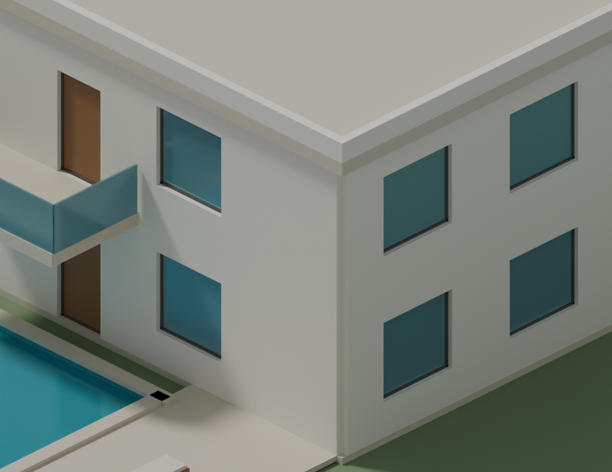
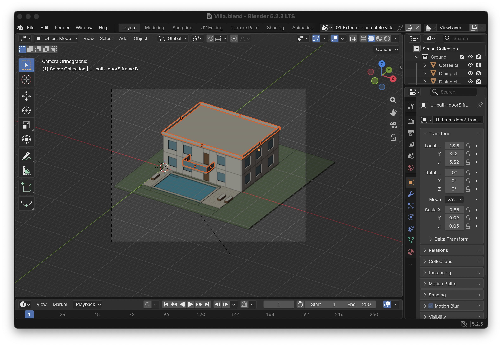
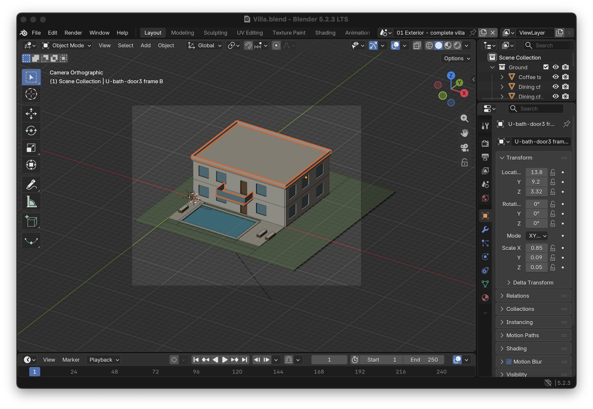
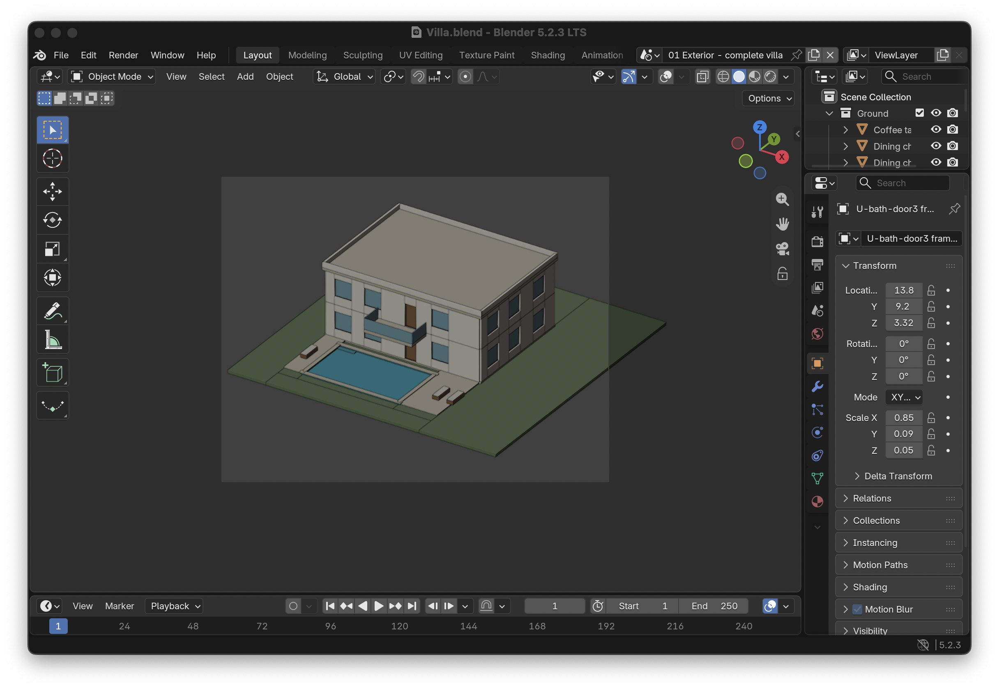
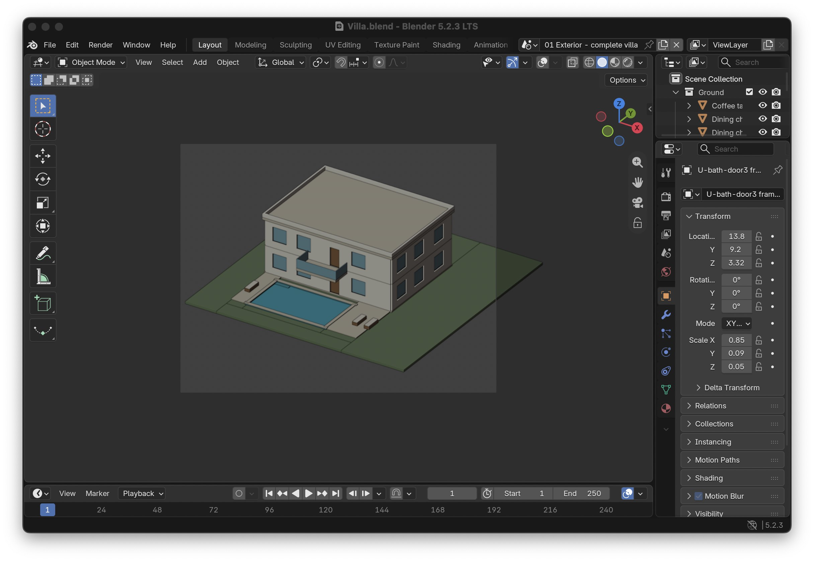

# Measured villa topology repair — 2026-10-24

CONCEPT / NOT FOR CONSTRUCTION. Proposed 16 × 12 m centreline footprint,
levels 0/+3.3 m. No surveyed site or measured photo reconstruction is claimed.
This work is stacked on unmerged PR #25 (`3c9ffcff36d589028e157286e35fce89ac274ccd`),
which depends on unmerged PR #23. No merge authority follows from this evidence.

## Diagnosis and change

| Issue | Native measurement | Repair / interpretation |
| --- | --- | --- |
| #27 | 49 intersecting wall-box pairs; summed pair intersections 2.219058627 m³ | Export only the occupied wall union boundary, grouped by level/material/explicit joint group. This sum is pairwise, not the unique volume removed. |
| #28 | 137 separately closed wall fragments; eight windows partly occupied by perpendicular partitions | Subtract all declared aperture envelopes through their host thickness, then emit one continuous boundary per compatible group. Preserve 27 source wall IDs and 43 opening hosts/dimensions. |
| #29 | Four parapet corner intersections ≈0.020 m³ each; two balcony guard intersections ≈0.0006875 m³ each; parapet bases buried 50 mm into roof slab | Union only declared parapet/guard groups; trim parapet bases to roof top +6.80 m, retain top +7.25 m. Retain roof and balcony slabs, glass guards and legitimate thin frames. Orange outlines are selection overlays, not stray exported solids. Use **Refs #29**, since the highlighted bands themselves are intentional members. |

Examples: `wall_L00-S_0000` intersects `wall_L00-W_0054` (source
`L00-S` / `L00-W`); `wall_L00-S_0006` intersects
`wall_L00-hallW_0058`. All four `Parapet {south,north,west,east}` objects
and `Balcony front guard` / `Balcony side {5.5,10.5}` are explicitly mapped.
The eight blocked windows are `L00-E0/E1`, `L01-E0/E1/E2`, and `L01-W0/W1/W2`.
Their intruding partitions are `G-ensuite2`, `G-service1`, `U-bath-h1`,
`U-eastdivide`, `U-bath-h3`, `U-bath-h2`, `U-westdivide`, `U-bath-h0`, respectively.

The repaired full exterior has **442 meshes**, including two wall boundaries,
one parapet ring and one balcony guard group. There are **18,224 raw GLB triangles**.
All other original exterior objects remain separate. Both cutaway scenes have
rebuilt, correctly clipped wall/guard counterparts. Source boxes remain inputs,
not an assertion that one exported object exists for every fragment.

## Native visual evidence

Actual Blender 5.2.3 LTS Cycles renders, same camera/settings. The original black
parapet corner artifact is gone; facade floor joints and opening frames remain.
The intermediate repair exposed the buried roof/parapet overlap; that failed
render is retained locally and is not used as final acceptance evidence.

| Original | Repaired |
| --- | --- |
|  |  |
|  |  |
|  |  |

[Repaired full villa render](evidence/villa-topology-20261024/after-exterior.png).
Screenshots come from a separately launched, PID-identified inspection window;
they are JPEG copies of retained original PNG captures. Selection toggles never
saved to the original or repaired model. Original user chat screenshots were not
mounted; these reproduce the exact stored model instead.

## Reproduction and evidence locations

Worktree: `/private/tmp/gridline-villa-topology-20261024`.
Evidence root: `/private/tmp/gridline-villa-topology-evidence-20261024-v1`.
Final sample: `repaired-v2/Villa.blend`, `repaired-v2/Villa.glb`,
`repaired-v2/villa.scene.json` under that root. `repaired/` is an intermediate
artifact, not the final deliverable. Temporary paths are not permanent storage.

```sh
BLENDER=/Applications/Blender.app/Contents/MacOS/Blender
# Both modes run in separate background processes with embedded autoexecution off.
"$BLENDER" --background --factory-startup --disable-autoexec --python-exit-code 1 \
  --python tests/villa_topology_acceptance.py -- build ORIGINAL_DIRECTORY NEW_DIRECTORY
"$BLENDER" --background --factory-startup --disable-autoexec --python-exit-code 1 \
  --python tests/villa_topology_acceptance.py -- verify ORIGINAL_DIRECTORY NEW_DIRECTORY
```

`build` refuses an existing output directory and loads the original without
saving it. It writes baseline rejections, source decisions (including original
parapet dimensions), input program hashes and the repaired source scene.
`verify` reopens the saved native file and imports GLB into an empty host.
`original/` retains copies of the original `.blend`, GLB, scene/building JSON,
`prepare.py`, `build_blender.py`, manifests and README. All nine original hashes
were rechecked after native inspection. The exact hashes, inventory and measured
union volumes are in [the machine receipt](VILLA_TOPOLOGY_EVIDENCE.json).

Canonical code is in the portable architectural-drawing-generation skill;
Claude copies are synchronized. The original villa preparation programs remain
source provenance; the reproduction script applies the explicit repair decisions.
No existing original file, user Blender session, preferences, permissions,
credentials, PR #24 or PR #26 worktree was changed.

## Verification contract

The generator constructs a bounded orthogonal occupancy boundary. The separate
`mesh_qa.py` reader checks world coordinates, oriented closed edges, vertex fans,
unused vertices, inside/outside face witnesses, source/aperture boundary coverage
and signed volume against an analytic interval sweep. It never imports the mesher.
Every source ID, role, opening host and material slot is compared with the typed
inventory. Unknown/helper roles and extra/missing meshes fail. The raw GLB reader
checks embedded buffers/accessors, actual indexed triangles, duplicates,
degeneracy and normals **before** Blender can sanitize mesh data. It follows the
[Khronos glTF 2.0 buffer/accessor and GLB specification](https://github.com/KhronosGroup/glTF/blob/main/specification/2.0/Specification.adoc);
external buffers, sparse accessors and geometry extensions are unsupported.
The source villa's material-transmission extension is allowed; shader fidelity
is not certified.

Construction rounding is 0.0001 mm; it does not snap gaps closed. Pure geometry
tests distinguish ±0.05 mm offsets. Native/GLB topology coordinates weld at
0.01 mm for split-normal vertices; box corner comparisons retain the earlier
0.25/1 mm limits. Volume tolerance is max(0.001 m³, volume × 1e-5), supplemented
by per-member/aperture boundary witnesses so a missing small closed member cannot
pass solely because of that aggregate tolerance. Unsupported or degenerate joins
fail instead of being silently healed.

Portable tests cover L/T/cross and unequal-thickness joints, two storeys, translated
and rotated layouts, offset gaps, door/window combinations, wide/adjacent windows,
full-height and near-corner glazing, invalid overlapping openings, roof/guard
corners, valid thin roles, unknown helpers, missing small closed members, reversed
normals, missing/extra surfaces, malicious buffers and resource limits. Baseline
original surfaces fail the independent boundary oracle. Native adversarial tests
lower a real opening head **without changing exterior bounds**, mutate both formats,
and seed duplicate triangles directly into GLB bytes (the exporter can sanitize
in-memory duplicate faces).

Commands and final results are recorded in the machine receipt. Linux CI runs the
pinned CAD suite and provider checks. Windows CI runs installer plus portable
topology/GLB regressions. Actual native Blender execution is measured on macOS;
Linux/Windows native Blender execution is not claimed. Check the implementing
PR's **final-head** CI, not an earlier run.

## Bounded review and exclusions

One agent performed the implementation and a connected-caller Ponytail,
architecture and security self-review. Review added precision preservation,
raw binary checks, boundary completeness, modifier/visibility rejection and
module hashes in receipts. No independent agent review or native inference was
launched; no software was installed. Headroom was used on a worker source read;
its stored original was retrieved before edits. The configured proxy was
unreachable; no billed-token or cost savings are claimed.

This is not a general oblique/BRep kernel. Mixed oblique joins, curved walls,
construction/material intent, arbitrary mesh certification, manufacturing frames,
structure, drainage, legal/code compliance, reference-photo fidelity, IFC and
native DWG acceptance remain outside this fix. Explicit material/level joints
remain separate; intentional stair-rail/post intersections and pool/coping joins
were inventoried but not redesigned. No blanket thin-strip deletion or global
coplanar dissolve was used. No issue is closed and no PR is merged by this work.
